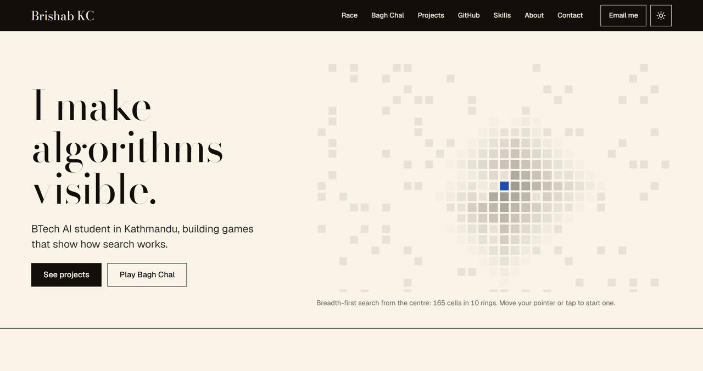
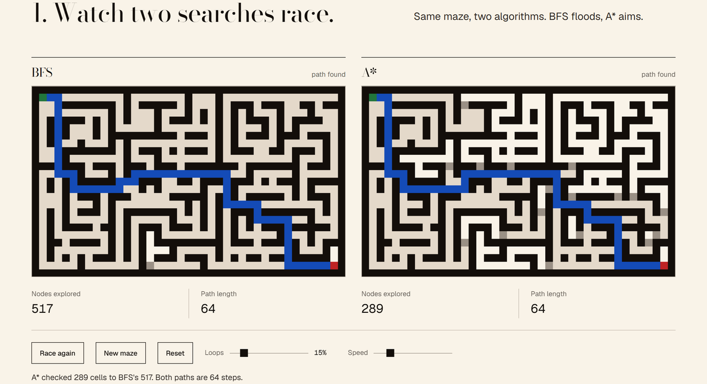
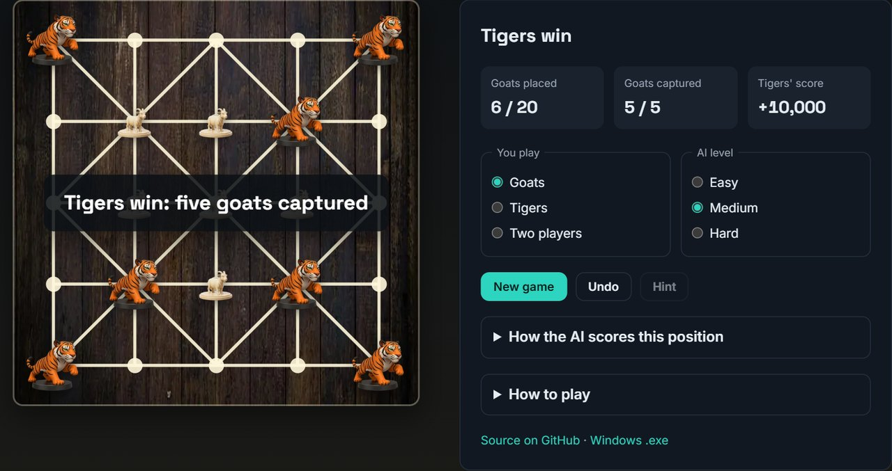

# brishabkc24.github.io

My portfolio: one hand-built page in HTML, CSS and JavaScript. No framework,
no build step, nothing to install. It shows who I am and lets you play my
projects in the browser instead of just reading about them.

**Live:** https://brishabkc24.github.io



## What is on the page

- **Hero** with a live canvas background. Moving the pointer starts a
  breadth-first search from the cell under it, and each ring of the flood
  lights up as it is reached. With `prefers-reduced-motion` it draws one
  finished search and stays still.
- **Try one**: my Maze Pathfinding Visualizer, ported to the browser. BFS and
  A\* race through the same maze side by side, with counters for cells
  explored and path length, a slider for how many loops the maze has, a speed
  slider, pause and reset. Under 480px it shows a recording instead.
- **Play Bagh Chal**: my desktop Bagh Chal game, playable in the browser. Play
  goats or tigers against the minimax AI at three levels, or two players on one
  screen, with undo, hints, and a panel that shows exactly how the AI scores
  the position.
- **Projects** in a bento grid: Bagh Chal, the Maze Pathfinding Visualizer and
  Math Tug Arena, with star and fork counts pulled from the GitHub API.
- **Skills** as chips, **GitHub activity** (stats, the contribution graph and
  the three most recently pushed repos, live), **About** as a profile card,
  and a **Contact** panel with email, GitHub, Instagram and Facebook.





## How it is built

| File | What it does |
| --- | --- |
| `index.html` | The page: semantic sections, one `h1`, Open Graph and Twitter tags, a skip link, an inline SVG icon sprite. |
| `styles.css` | Design tokens as CSS variables; dark by default, light on `[data-theme="light"]`; breakpoints at 1100, 720 and 480px; one layout per section. |
| `script.js` | Nav, theme toggle (saved in `localStorage`, follows the OS setting until you pick one), scroll reveals, the GitHub API fetch (cached in `sessionStorage`), and the hero canvas. |
| `demos/maze-race.js` | The maze demo: recursive-backtracker generator, braiding, BFS and A\* as generator functions, and one `requestAnimationFrame` loop that steps both in lockstep. |
| `demos/bagh-chal.js` | Bagh Chal: the rules engine (neighbour table, placement and movement phases, captures, threefold repetition, undo) and the minimax search with alpha-beta pruning, ported from my Python game, plus the board UI. |
| `404.html` | What GitHub Pages serves for unknown paths. |

The page renders fully without JavaScript; the scripts only add the demos and
the live numbers. All motion is gated behind `prefers-reduced-motion`.

Lighthouse on a local build (mobile): Performance 97, Accessibility 100,
Best Practices 100, SEO 100.

## Run it locally

Any static server works. With Python:

```
python -m http.server 8000
```

Then open http://localhost:8000.

## Deploy

GitHub Pages serves the `main` branch. Every push republishes the site at the
URL above; there is no workflow to maintain.
